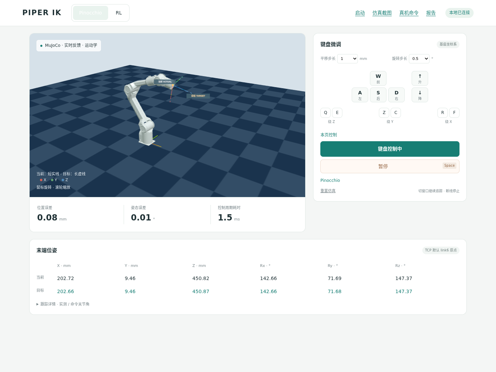

# Piper IK · ROS-free

Piper 六轴机械臂的末端位姿控制台：**Pinocchio 数值 IK / PPO 学习 IK**，浏览器键盘操作，MuJoCo / Isaac Sim 可视化，可选官方 Piper SDK 真机执行。

**不需要 ROS、roscore 或 ROS 工作空间。** URDF/网格来自开源 Piper 模型，但运行和训练都不依赖 ROS。模型、现有 PPO 权重和前端资源已包含，无需下载 FastUMI 数据。

> 当前仿真是关节位置写入后的运动学可视化，不是电机动力学仿真。RL 是 IK 求解器，不是视觉任务策略，也不包含碰撞规避或 VLA action-chunk 调度。默认不会连接、使能或控制真机。

[HTML 阅读版](README.html) · [RL 训练与 reward](docs/RL.md) · [Pinocchio 与代价函数](docs/PINOCCHIO.md) · [真机操作](docs/HARDWARE.md) · [验证边界](docs/VALIDATION.md)



## 1. 安装

推荐 Ubuntu 22.04 / 24.04、Python 3.12。CPU 即可运行两种 IK；RL 训练另需 NVIDIA CUDA GPU。Isaac Sim 单独安装。

```bash
git clone https://github.com/kelo020304/piper-IK.git
cd piper-IK
python3.12 -m venv .venv
source .venv/bin/activate
python -m pip install --upgrade pip
python -m pip install -r requirements.txt
```

已有 Python 环境可直接设置 `PIPER_IK_PYTHON=/absolute/path/to/python`。启动脚本依次使用该变量、仓库 `.venv/bin/python`、PATH 中的 `python3`，并清理 ROS 常见的库路径污染。

安装依赖若失败先确认 Python 版本；本仓库固定 `pin==3.7.0`、`ruckig==0.12.2`，不保证其他组合。已测试环境见 [版本记录](docs/runtime_versions.json)。

## 2. 启动与切换

```bash
# MuJoCo 原生窗口 + 网页，Pinocchio
./run.sh --sim mujoco --ik pinocchio

# 先 Ctrl+C 退出上一实例，再启动 RL
./run.sh --sim mujoco --ik rl

# 无原生窗口，保留网页模型及仿真截图
./run.sh --sim mujoco --ik rl --headless

# Isaac Sim 自带 python.sh 路径由用户提供；主控制台仍使用 .venv
./run.sh --sim isaac --ik pinocchio --isaac-python /absolute/path/to/isaacsim/python.sh
```

浏览器打开 **http://127.0.0.1:8765**，点击“接管键盘”。顶部可直接切换 Pinocchio / RL；切换仿真器需要退出并重新启动。只启动仿真可用 `--port 8766`；真机不得用多个端口同时控制同一 CAN。

键盘沿**机器人基座轴**操作，不沿摄像机或当前末端轴：W/S 为 ±X，A/D 为 ±Y，↑/↓ 为 ±Z；Q/E 绕 ±Z，Z/C 绕 ±Y，R/F 绕 ±X。平移步长为 mm，旋转步长为度。按住按键持续更新目标；后台约 50 Hz 求解和发送轨迹，键盘增量最多约 11 Hz。切窗口只清除按键，已接受目标仍继续跟踪；断开控制连接或点击暂停会停止。

## 3. 每一步到底是绝对量还是相对量

约定 `T_BF` 表示 **tool0 坐标系 F 在基座 B 中的位姿**，作用为把 F 中坐标变换到 B。基座与仿真 world 重合。单位：m、rad；显示可转换为 mm、度。

`tool0` 在当前六轴模型中与 `link6` 原点重合；代码中的 `flange` 指这个模型帧，不自动等于你夹爪尖端。

| 阶段 | 输入 / 输出 | 绝对或相对 | 坐标系与实现 |
| --- | --- | --- | --- |
| SDK 反馈 | 六个关节角 `q_measured` | 绝对关节配置 | `q_model = radians(raw / 1000) - zero_offset`；关节不是 xyz 坐标 |
| 正运动学 | `T_BF = FK(q)` | 绝对位姿 | 基座 → tool0；[engine.py](piper_ik/engine.py) 的 `flange()` |
| TCP 配置 | `T_FT` | 固定相对位姿 | `tcp_xyz_m` 是 TCP 原点在 tool0 中的位置；`tcp_rpy_deg` 为 SciPy 小写 `xyz` 外禀欧拉角 |
| 当前 TCP | `T_BT = T_BF @ T_FT` | 绝对位姿 | 基座中的实际工具位姿；默认 TCP 偏移为零 |
| 键盘平移 | `p_goal += Δp_B` | 增量输入 → 绝对目标 | 累加到上一个目标，不累加到滞后的实测位置 |
| 键盘旋转 | `R_goal = Exp(Δθ_B) @ R_goal` | 增量输入 → 绝对朝向 | 左乘：绕基座轴，TCP 位置保持不变；不是绕世界原点公转 |
| 外部 `pose_target` | `position_m` + `quaternion_xyzw` | **绝对 TCP 目标** | 必须 `frame: base`，覆盖目标，不再次累加 |
| 末端参考平滑 | `T_BT_goal → T_BT_ref` | 绝对参考位姿 | 三层低通；平移线性、旋转按最短旋转向量过渡 |
| 转换 IK 目标 | `T_BF_goal = T_BT_ref @ inverse(T_FT)` | 绝对 tool0 位姿 | 两个 IK 求解器接收同一种目标 |
| Pinocchio IK | `Log(T_current⁻¹ @ T_goal)` → `Δq` → `q_ik` | 局部相对误差 → 绝对关节解 | 误差/Jacobian 在当前 tool0 的 LOCAL 帧表达；不是改变目标坐标系 |
| RL IK | 当前/目标绝对 pose + 误差 → `Δq` → `q_ik` | 策略输出关节增量 | `q_ik = clip(q + 0.2 × action)`；不是直接输出末端增量 |
| Ruckig | `q_ik` → `q_command` | 绝对关节目标 → 连续关节采样 | 保留上一拍规划速度、加速度；按速度/加速度/jerk 约束过渡 |
| SDK 发送 | `JointCtrl(J1,...,J6)` | **绝对电机关节角** | `round(degrees(q_command + zero_offset) × 1000)`；SDK 单位为 0.001° |
| 显示 | actual / target / reference | 基座中的绝对 TCP 位姿 | 真机 actual 来自实测关节 FK；command 与 actual 不混用 |

### 四元数与旋转：不要混用

- WebSocket、SciPy、浏览器：`[x,y,z,w]`；单位旋转是 `[0,0,0,1]`。
- RL 26 维观测内部、MuJoCo：`[w,x,y,z]`，规范到 `w ≥ 0`；代码完成转换。
- RL 姿态误差为 `Log(R_goal @ R_current.T)`，在基座轴表达；Pinocchio 用 LOCAL SE(3) 误差。两种内部误差不同，但接收同一个基座绝对目标。
- 当前实机没有额外全局定位：这里的“绝对”是**相对机器人基座固定原点**，不是房间地图坐标。

### 接入你自己的末端策略

同源 WebSocket `/ws` 先发送 `{"type":"claim"}` 获取控制权，硬件模式还需连接、使能。每条消息处理完成返回 `ack`，错误返回 `error`，状态异步推送。

下面是**格式示例，不是通用安全目标**，先在仿真中用当前 actual 附近的小目标测试：

```json
{
  "type": "pose_target",
  "frame": "base",
  "position_m": [0.25, 0.0, 0.30],
  "quaternion_xyzw": [0.0, 0.0, 0.0, 1.0]
}
```

如果上游给的是基座增量：`p_next = p_previous_goal + Δp_B`、`R_next = Exp(Δθ_B) @ R_previous_goal`。如果给的是工具局部平移/旋转：`p_next = p_previous_goal + R_previous_goal @ Δp_T`、`R_next = R_previous_goal @ Exp(Δθ_T)`。先按上游定义转换，再发绝对目标。不要把相对动作直接填进 `position_m`。

这里仅处理最新目标，**没有 action chunk 的时间戳、队列或延迟补偿**。FastUMI / π0.5 输出的坐标系、旋转编码和夹爪动作需要独立适配；本仓库不控制夹爪开合。

## 4. 真机：显式授权后再操作

```bash
source .venv/bin/activate
python -m pip install -r requirements-hardware.txt

# 仅在 can0 尚未配置且没有控制程序连接时配置；这里不会启动电机
sudo ip link set can0 down
sudo ip link set can0 type can bitrate 1000000
sudo ip link set can0 up
ip -details link show can0

./run.sh --sim mujoco --ik pinocchio --allow-hardware --can can0
# RL 使用 --ik rl；先退出上一控制台
```

网页顺序：**接管 → 连接 → 使能 → 回零 → 键盘操作**。启动命令本身不连接、不使能、不回零。详细行为见 [真机文档](docs/HARDWARE.md)。

“回零”是 **SDK 的六关节角归零**，模型目标为 `-joint_zero_offsets_rad`，与 `initial_q`、首次使能姿态不同。“返回安全位置并失能”返回本次 CAN 连接首次成功使能时的关节姿态，到位稳定保持 3 秒后失能；这个姿态由用户确认物理上安全。

## 5. 常用调整

编辑 `config.json`，或用 `./run.sh --config /absolute/path/to/my-config.json ...`。运行中不自动重新加载。`--can` 与 `--allow-hardware` 只对当前进程生效。

| 参数 | 默认 | 调整意义 |
| --- | --- | --- |
| `target_filter_tau_s` | 0.06 s | 三层参考滤波的每层时间常数；增大更平滑、滞后更大；不是固定延迟 60 ms |
| `max_joint_acceleration_rad_s2` | 1.0 | Ruckig 软件加速度；越小启动/制动越柔和，也更慢 |
| `max_joint_jerk_rad_s3` | 10.0 | 限制加速度变化率；降低可减轻突变，也增加跟踪滞后 |
| `max_joint_velocity_rad_s` | null | 不加额外统一速度上限；真机仍使用 SDK 读回的逐轴上限，仿真使用 URDF 上限 |
| `target_linear_speed_m_s` / `target_angular_speed_rad_s` | null / null | 不额外限制每层末端参考的速度；滤波仍有效 |
| `speed_percent` | 5 | SDK 运动速度百分比，不是 rad/s；当前代码接受 1–20 |
| `home_velocity_rad_s` | 0.08 | 回零/返回首次使能姿态的关节速度上限，不随 IK 模式改变 |
| `tcp_xyz_m` / `tcp_rpy_deg` | 全零 | tool0 → 实际 TCP 的固定变换；自制夹爪必须校准 |
| `joint_zero_offsets_rad` | 全零 | SDK 零点与模型零点之间的偏移；不是末端坐标偏移 |
| `initial_q` | 配置内六轴数组 | 仅仿真/未连接时占位初姿；真机使能时从反馈初始化 |

Pinocchio 的误差权重、阻尼、迭代次数在 [独立文档](docs/PINOCCHIO.md)；RL 的 reward、观测、训练命令在 [独立文档](docs/RL.md)。

## 6. 测试与维护

```bash
python -m pip install -r requirements-dev.txt
python -m pytest -q
python tools/build_docs.py
python training/evaluate.py --ik rl --samples 256 --out artifacts/rl-evaluation.json
python training/evaluate.py --ik pinocchio --samples 256 --out artifacts/pin-evaluation.json
```

测试使用 fake SDK，不触碰 CAN。MuJoCo 子进程测试为 headless；原生截图需要本机可用的 EGL/OpenGL。Markdown 是维护源，HTML 为同步生成的离线阅读版，可用 `python -m http.server 8000` 打开 `http://127.0.0.1:8000/README.html`。

## 7. 目录与许可

```text
piper_ik/          控制、IK、轨迹、SDK、WebSocket
training/          MuJoCo-Warp PPO 训练与 CPU 独立评估
assets/models/     URDF、MJCF、网格、模型来源
assets/weights/    现有 PPO checkpoint 与配置/哈希
web/              离线前端、Three.js
docs/             RL、Pinocchio、真机、仿真与验证文档
tests/            控制及协议测试，硬件使用 fake SDK
tools/            文档构建、可选 SDK 加速度工具
```

代码以 MIT 发布，第三方模型和前端保留原许可。见 [LICENSE](LICENSE)、[第三方来源](THIRD_PARTY.md)。权重训练来源与限制见 [metadata.json](assets/weights/metadata.json)。
